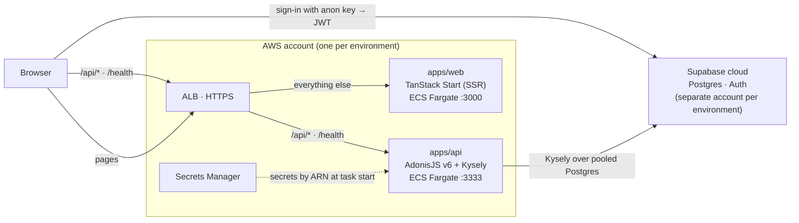

# 🧭 System Overview

What the components are, how requests flow between them, and the reasoning behind the design.

| Part | Role | Detail |
| --- | --- | --- |
| `apps/web` | SSR web app. Signs users in with Supabase and sends the access token as a Bearer header to the API | [web-frontend-gateway.md](./web-frontend-gateway.md) |
| `apps/api` | REST API. Verifies the Supabase JWT, keeps domain logic free of framework code, queries Postgres with Kysely | [clean-backend-api.md](./clean-backend-api.md) |
| `packages/contracts` | OpenAPI contract generated from the API, consumed by the web client | [workflows/type-safe-contracts.md](../workflows/type-safe-contracts.md) |
| `packages/db` | The Kysely `Database` types shared by the API | [database/overview.md](../database/overview.md) |
| `tools/supabase` | Local Supabase CLI stack and the migrations | [workflows/database-migrations.md](../workflows/database-migrations.md) |
| `tools/infra/aws` | OpenTofu for everything in the AWS box above | [deployment/aws.md](../deployment/aws.md) |

Why it is shaped this way:

- **One ALB, same paths as local.** The browser always calls relative `/api/*`, locally through the
  Vite proxy and deployed through the ALB, so that no environment-specific URL lives in app code
  and dev stays a faithful rehearsal of prod.
- **The web app holds no secrets.** Everything it ships is public, so that a leaked bundle leaks
  nothing. Only the API reads secrets ([security/secrets-inventory.md](../security/secrets-inventory.md)).
- **Supabase does auth and storage, the API does business logic.** Users authenticate directly
  against Supabase, and the API trusts only a verified JWT, so that the API never handles passwords.
