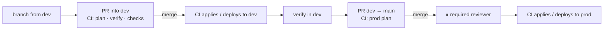

# ☁️ Deployment on AWS

How a change to `apps/web`, `apps/api`, the schema or the infrastructure gets from a branch to dev and
then production. The testable form is
[`openspec/specs/aws-deployment/spec.md`](../../openspec/specs/aws-deployment/spec.md). The system's
shape is in [architecture/overview.md](../architecture/overview.md).

> **The one rule:** nobody deploys to production by hand, and nobody has standing access to it, so
> that what runs in prod is always what `main` says. A human reading a plan is the gate
> ([security/production-access.md](../security/production-access.md)).

---

## 1. Environments

| | dev | prod |
| --- | --- | --- |
| Branch | `dev` | `main` |
| AWS account | `<account-id-dev>` | `<account-id-prod>` |
| Supabase | separate **dev** Supabase account | separate **prod** Supabase account |
| Inputs | `tools/infra/aws/environments/dev.tfvars` | `…/prod.tfvars` |
| Apply / deploy | automatic on merge | **required reviewer** on the `prod` GitHub Environment |
| Human access | normal dev access | **none standing** |

There are exactly two environments, in separate accounts, so that a mistake in dev stays in dev and
dev access gives no path to production. Supabase follows the same split; see
[database/overview.md](../database/overview.md).

## 2. Release path



Read the plan posted on the PR: the summary line first, then every `-` (destroy) and `-/+`
(replace), which on anything holding data means data loss. When promoting `dev` → `main`, compare
the prod plan with the earlier dev plan: only sizes and names should differ.

| Workflow | Trigger | Environment(s) | Role |
| --- | --- | --- | --- |
| `infrastructure.yml` | PR / push on `tools/infra/**` | plan: `dev-plan` / `prod-plan`; apply: `dev` / `prod` | plan → `AWS_PLAN_ROLE_ARN`; apply → `AWS_ROLE_ARN` |
| `infrastructure-drift.yml` | nightly | `dev-plan`, `prod-plan` | plan role, `-detailed-exitcode` |
| `deploy-api.yml`, `deploy-web.yml` → `deploy-ecs-app.yml` | push on the app's paths + `packages/**` + the workflow | `dev` / `prod` | `AWS_DEPLOY_ROLE_ARN` |
| `database.yml` | PR / push on `tools/supabase/**` | PR: none (local DB); push: `dev` / `prod` | `AWS_DEPLOY_ROLE_ARN` |
| `repo-checks.yml` | every PR | none | none (secret scan, single lockfile) |

In the starter template repository itself (`nebula-horizon/fullstack-ai-project-starter`), which
has no AWS accounts, every job that reaches AWS is skipped by an `if:` on the repository name, while
`infrastructure.yml`'s `validate` job (fmt, tflint, validate) still runs. A project created from the
template has a different name, so its jobs run, and fail closed until [GitHub setup](#4-github-setup)
is done.

Infrastructure and application deploys are separate workflows, so that a frontend commit
never queues an infra plan and an infra change never rebuilds an app.

Guardrails: `prevent_destroy` on the VPC and secrets; the protected-resource plan gate
(`.ci/scripts/check-protected-resources.sh`); apply of the saved plan
artifact only; path filters; pinned OpenTofu `1.10.10`, provider and tflint; `tofu fmt -check`;
tflint; nightly drift detection; post-apply and post-deploy health checks; required reviewer on `prod`.

## 3. Infrastructure code — `tools/infra/aws/`

| File | Holds |
| --- | --- |
| `main.tf` | `terraform {}` (OpenTofu `~> 1.10`, AWS `~> 6.0`, partial S3 backend with `use_lockfile`), provider with `default_tags` and `allowed_account_ids`, locals |
| `variables.tf` | Every input, validated. A leftover `<placeholder>` fails validation on purpose |
| `vpc.tf`, `security-groups.tf`, `alb.tf` | Network; ALB with HTTPS and an HTTP→HTTPS redirect; `/api/*` and `/health` routed to the API like the local Vite proxy |
| `ecr.tf`, `ecs.tf`, `iam.tf` | Image repos (immutable tags), Fargate services, task execution/task roles |
| `secrets.tf`, `ssm-config.tf` | Secret containers and parameters — see [security/secrets-inventory.md](../security/secrets-inventory.md) |
| `iam-github-actions.tf` | OIDC provider; plan, apply and deploy roles; state-bucket read policy |
| `outputs.tf` | ARNs and names to copy into GitHub Environments |
| `environments/{dev,prod}.tfvars` | The per-environment answer sheet (non-secret) |
| `bootstrap/create-state-bucket.sh` | Creates the state bucket once per account, by hand, before anything else |

Split ownership: OpenTofu owns how each ECS service runs (size, network, roles); the deploy workflows own the image
and task-definition revision (`ignore_changes = [task_definition]`), so that an unrelated infra
apply never rolls an app back. An infra-only change to a task definition takes effect on the next
app deploy.

Locally you may run `tofu init`, `validate`, `plan` against **dev**. `apply` and `destroy` are
CI-only everywhere.

## 4. GitHub setup

Repository **variables**: `AWS_REGION`, `PRODUCT`, `DEV_ACCOUNT_ID`, `PROD_ACCOUNT_ID`. No AWS keys
and no application secrets live in GitHub.

| Environment | Protection | Variables |
| --- | --- | --- |
| `dev` | deployment branches: `dev` only | `TF_STATE_BUCKET`, `AWS_ROLE_ARN`, `AWS_DEPLOY_ROLE_ARN` |
| `prod` | **required reviewers**; deployment branches: `main` only | `TF_STATE_BUCKET`, `AWS_ROLE_ARN`, `AWS_DEPLOY_ROLE_ARN` |
| `dev-plan` | none, deliberately — a plan never waits | `TF_STATE_BUCKET`, `AWS_PLAN_ROLE_ARN` |
| `prod-plan` | none, deliberately | `TF_STATE_BUCKET`, `AWS_PLAN_ROLE_ARN` |

Branch protection on `dev` and `main`: PR required, passing checks, no force-push; `main` also
requires an approving review, and Code Owners review once `CODEOWNERS` has real teams.

## 5. Bootstrapping an environment

Steps 1–3 and 7 need the admin, because nobody else holds elevated access.

1. The admin provides the AWS account and the Supabase account for the environment.
2. The admin runs `tools/infra/aws/bootstrap/create-state-bucket.sh`.
3. The admin creates the OIDC provider and the plan and apply roles once, paired and witnessed, with
   the command and output recorded. This is the one sanctioned human apply. After it, the roles
   change only through CI. The deploy role and the state-bucket policy follow in the first CI apply.
   ```bash
   tofu apply -var-file=environments/<env>.tfvars \
     -target=aws_iam_openid_connect_provider.github \
     -target=aws_iam_role_policy_attachment.plan_read_only -target=aws_iam_role_policy.plan_state \
     -target=aws_iam_role_policy_attachment.apply_admin -target=aws_iam_role_policy.apply_guardrails
   ```
4. Fill `environments/<env>.tfvars`.
5. Configure GitHub as in [§4](#4-github-setup).
6. First plan through CI: everything is `+`. Sanity-check the resource count.
7. Apply through CI. The admin then writes every value listed in
   [security/secrets-inventory.md](../security/secrets-inventory.md), and DNS is pointed at the
   `alb_dns_name` output.
8. Run `deploy-api` and `deploy-web`. Health checks must pass.

Until step 8 the services have no image, so the post-apply health check in step 7 fails. That is
expected on a brand-new environment.

## 6. Rollback

- **A bad app deploy that fails health:** the ECS deployment circuit breaker rolls the service back
  to the previous task definition automatically, and the workflow fails.
- **A bad deploy that passes health:** revert the commit and let it flow through the release path
  (dev, then a promotion PR). Never roll back by hand.
- **The apply succeeded and made things worse:** escalate to the system's owner and put the revert
  through the [release path](#2-release-path) as a normal change, not by hand under pressure.
