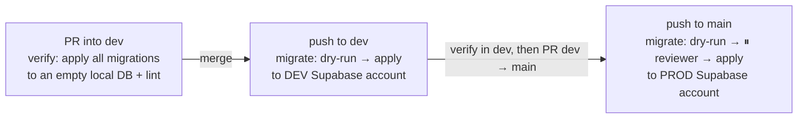

# 💾 Database Migrations Workflow

How a schema change goes from your laptop to the local stack, then the **dev** Supabase account,
then the **prod** Supabase account. Migrations reach dev and prod **through CI only, never from a
laptop.** The testable rules are in
[`openspec/specs/database-migrations/spec.md`](../../openspec/specs/database-migrations/spec.md). The
Supabase accounts are described in [database/overview.md](../database/overview.md), and where each
credential is stored in [security/secrets-inventory.md](../security/secrets-inventory.md).

> CI is the only thing that changes a hosted schema: dev on merge to `dev`, prod on promotion to
> `main`. That way every hosted schema change is reviewed and recorded.

---

## 1. Local Database Orchestration

The **Supabase local CLI** runs the development database stack (Postgres, Studio, Auth, Storage) in
Docker. `tools/supabase/` is the single source of truth for config and migrations.

**Working-directory quirk:** `supabase/config.toml` lives under `tools/`, so every Supabase CLI
command needs `--workdir tools`. The `mise run db:*` tasks already pass it. Without it you get a
confusing "cannot find project" error, not an obvious one.

### Custom Dev Ports Map
- **Postgres Database:** `127.0.0.1:54332`
- **Kong API Gateway (API):** `http://127.0.0.1:54326`
- **Supabase Studio Web Dashboard:** `http://127.0.0.1:54328`
- **Email (Mailpit) Web UI:** `http://127.0.0.1:54324`

---

## 2. Creating & Applying Migrations Locally

All schema and table changes MUST be raw DDL SQL files in `tools/supabase/migrations/`.

### Step 1: Create a new migration file
```bash
supabase migration new <migration_name> --workdir tools
```
This creates `tools/supabase/migrations/<YYYYMMDDHHMMSS>_<migration_name>.sql`. Keep that naming. The
CLI silently **skips** files that don't follow it. The original `00000000000000_init.sql` was skipped
this way, so the `profiles` table never existed (renamed to `20260524000000_create_profiles.sql`).

### Step 2: Write your DDL SQL
Tables, foreign keys, RLS policies, functions, triggers.

### Step 3: Apply migrations locally
```bash
mise run db:reset   # supabase db reset --workdir tools
```
Resets the local database and applies every migration in order.

---

## 3. TypeScript Types

`packages/db/src/types.ts` is the Kysely `Database` interface the API queries against. **Today it is
maintained by hand.** `mise run db:types` emits Supabase's own type format, which is not
Kysely-shaped, so running it overwrites the file with types the API cannot use. Until a
Kysely-emitting generator is wired in, update `types.ts` by hand in the same PR as the migration.

---

## 4. From your PR to dev and prod (CI)



`.github/workflows/database.yml`:

| Trigger | Job | Credentials |
| --- | --- | --- |
| PR touching `tools/supabase/**` | `verify`: `supabase db start` on an empty DB (every migration must apply), then `supabase db lint` | none |
| push to `dev` | `migrate` in the `dev` Environment: `supabase db push --dry-run`, then `supabase db push` | dev deploy role via OIDC → dev Secrets Manager `…/supabase-migrations` |
| push to `main` | `migrate` in the `prod` Environment: **waits for the required reviewer**, then dry-run and push | prod deploy role → prod Secrets Manager |

The connection string is read from Secrets Manager inside the job, masked, and lives only for the
job. It is never stored in GitHub.

**Never** run `supabase db push`, `supabase link`, or the Studio SQL editor against dev or prod from
your laptop. A schema change that bypasses CI is drift no migration describes.

---

## 5. Ordering with app deploys *(project decision)*

Migrations (`database.yml`) and app deploys (`deploy-api.yml`) are separate workflows and may run in
either order after one merge. So every migration MUST work with the app version **already
running**:

1. **Expand**: add the new table/column (nullable or with a default). Merge, let it reach the env.
2. **Deploy** the app code that uses it.
3. **Contract**: drop what the old code needed, in a later PR, after the new code is live in that env.

Never rename or drop something the running app reads in the same PR as the code change.

---

## 6. Preventing Schema Drift

Before committing, run `supabase db diff --workdir tools` to catch changes made in local Studio
(`http://127.0.0.1:54328`) that aren't in a migration file.
